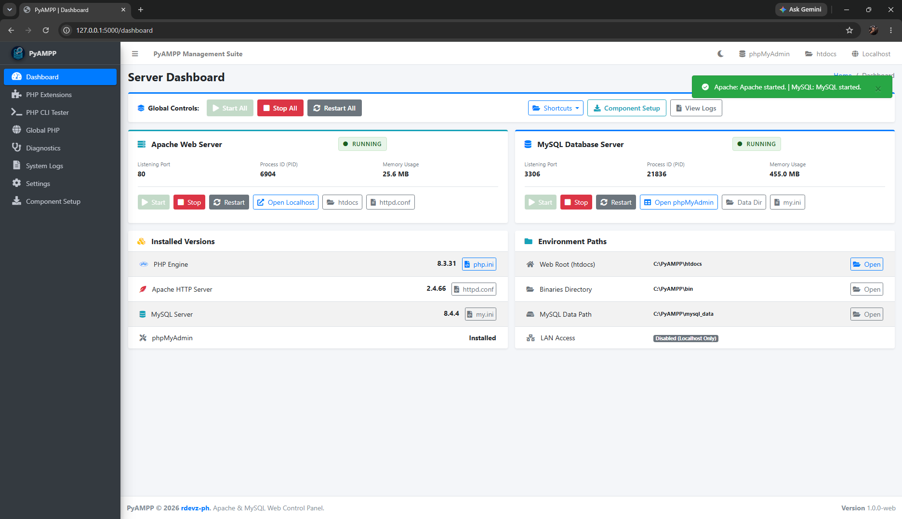
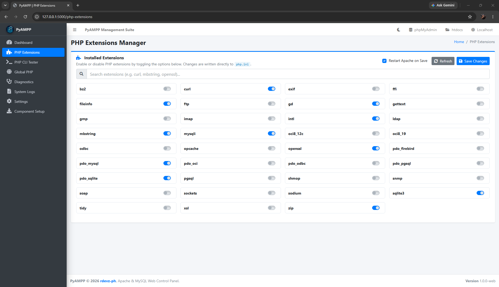
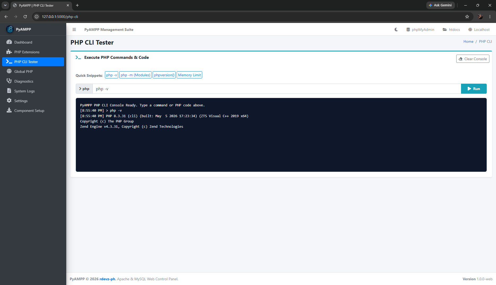
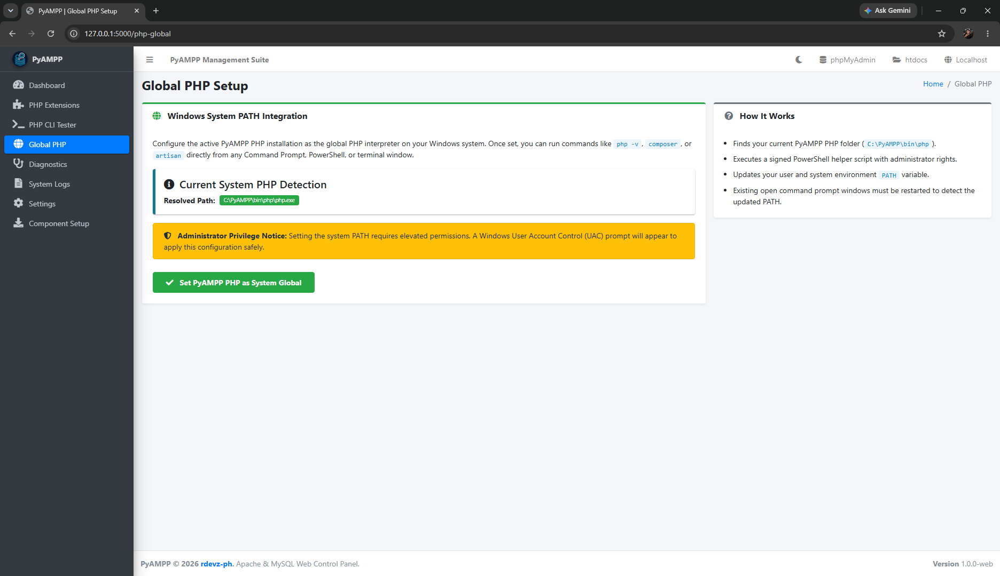
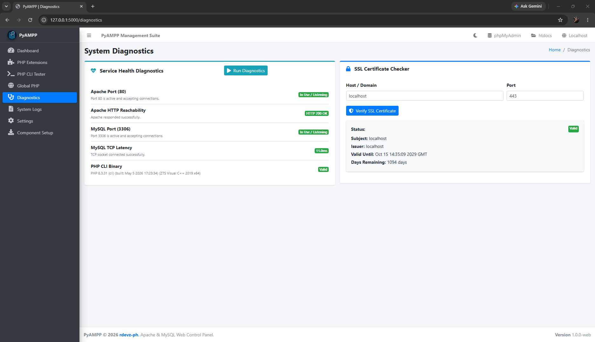
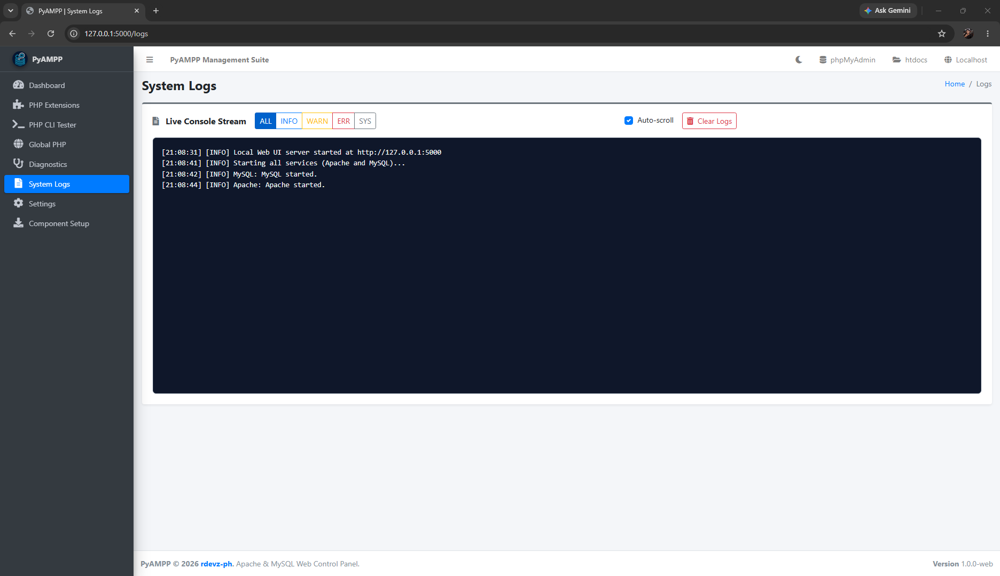
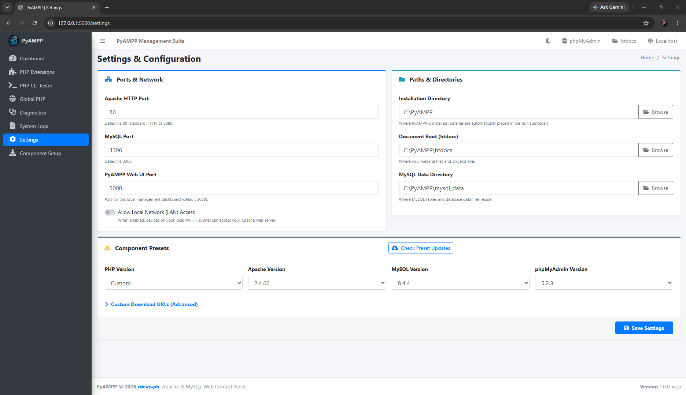
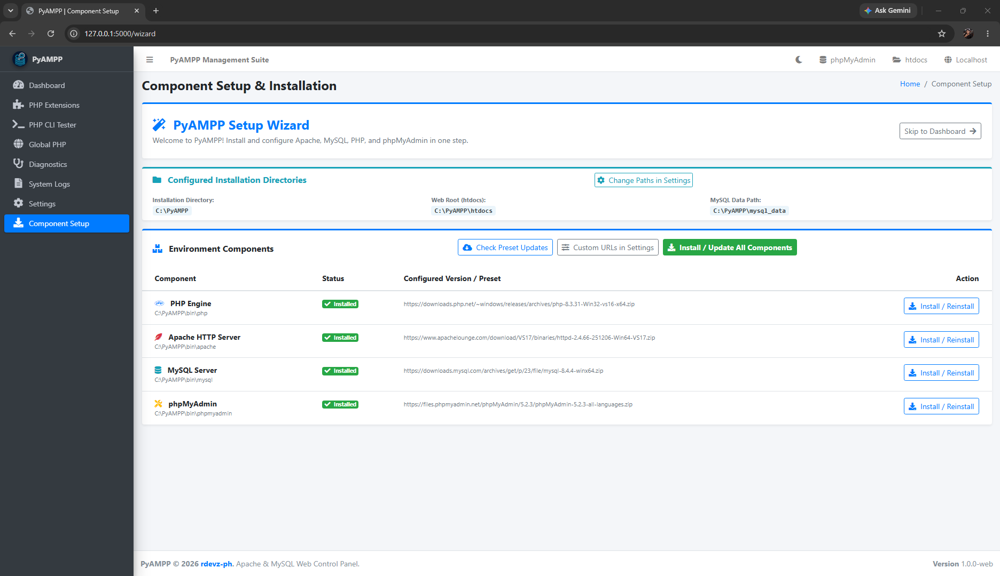

<div align="center">
  

  # PyAMPP
  <p><strong>Portable Web Development Stack Manager for Windows</strong></p>

  
  
  
  
  
</div>

> [!NOTE]
> This project is a continuation of [PyAMPP-Windows](https://github.com/rdevz-ph/PyAMPP-Windows), which is also a project of mine.

## Project Overview

PyAMPP is a portable web server manager for Windows. It provides a browser-based management dashboard and a lightweight system tray controller to set up, configure, and manage Apache, MySQL, PHP, and phpMyAdmin in one place.

## Download

Download the latest version from the [Releases](https://github.com/rdevz-ph/PyAMPP-Web/releases) page. Choose the newest release and download the executable file.

> [!WARNING]
> This tool is actively maintained. If you encounter an issue, please include your application version and report it on the [Issues](https://github.com/rdevz-ph/PyAMPP-Web/issues) page.

## Core Goals

1. **Portability:** Keeps software binaries, configuration files, and database storage in a designated installation directory so you can move or back up your environment without breaking paths.
2. **Ready to Use:** Automatically configures Apache, MySQL, and PHP so you do not need to edit configuration files manually.
3. **Easy Setup:** A built-in setup wizard downloads and installs the required components for you.

## Screenshots

| Web Management Dashboard | PHP Extensions Manager |
| :---: | :---: |
|  |  |
| **PHP CLI Tester** | **Global PHP Setup** |
|  |  |
| **Diagnostics & SSL Verification** | **Real-Time System Logs** |
|  |  |
| **Settings & Paths Configuration** | **Component Setup Wizard** |
|  |  |

## Features

### Web Management Dashboard
- Accessible locally at `http://127.0.0.1:5000` from any modern web browser.
- Live process monitoring displaying process IDs (PIDs), CPU usage, memory consumption, and port listening status.
- Global controls to start, stop, or restart all services with one click.
- Quick navigation shortcuts to local websites, phpMyAdmin, phpinfo, and configuration files.

### Service Management
- **Independent Processes:** Apache and MySQL run as standalone background processes and continue running even when the browser dashboard is closed.
- **Port Detection:** Automatically monitors port 80 and port 443 for Apache, and port 3306 for MySQL.
- **System Tray Controller:** A lightweight notification tray companion to access quick controls, open the web dashboard, or stop all services when exiting.

### Component Setup Wizard
- Choose from pre-tested versions of Apache, MySQL, PHP, and phpMyAdmin.
- Downloads official binaries directly from trusted project mirrors.
- Automatically initializes MySQL data directories and sets up initial database permissions.
- Upgrades or reinstalls component versions without deleting your existing databases or website files.

### PHP Tools
- **Extensions Manager:** Search, inspect, enable, and disable extensions in `php.ini` with one click and optional Apache restart.
- **PHP CLI Tester:** Run custom PHP code snippets and execute command-line instructions directly in the browser to test scripts and debug modules.
- **Global System PATH:** Register the portable PHP directory in the Windows system PATH using administrator elevation so you can run tools like Composer from the command line.

### Diagnostics and SSL
- **Port and Socket Tests:** Verify port availability and measure local socket connection latency.
- **SSL Auto-Fix:** Automatically generates self-signed certificates so you can test HTTPS on `localhost`.
- **Certificates Inspector:** Check the expiration date, issuer, and domain coverage of your local SSL certificates.

### Paths and Directories
- **Configurable Install Folder:** Set your base installation directory (such as `C:\PyAMPP`), with binaries organized automatically in the `bin` subfolder.
- **Custom Document Root:** Point your Apache web root (`htdocs`) to any folder on your drive without moving project files.
- **Dedicated MySQL Data:** Store database files in a separate directory to keep your data safe during software upgrades.

## Supported Versions

PyAMPP includes tested download presets for the following components:

- **PHP:** 8.5.6, 8.4.21, 8.3.31, 8.2.31, 8.1.34, 8.0.30, and 7.4.33
- **Apache:** 2.4.66
- **MySQL:** 8.4.4, 8.0.40, and 5.7.44
- **phpMyAdmin:** 5.2.3, 5.2.2, and 5.2.1

## Requirements

- **Operating System:** Windows 10 or Windows 11 (64-bit)
- **Runtime:** Python 3.10 or newer (for running from source)

## Building from Source

### 1. Clone the Repository
```bash
git clone https://github.com/rdevz-ph/PyAMPP-Web.git
cd PyAMPP-Web
```

### 2. Install Dependencies
```bash
pip install -r requirements.txt
```

### 3. Run Locally (Development)
```bash
python main.py
```

### 4. Build Standalone Executable
Run the build script to create a standalone executable file:
```bash
python build.py
```
The compiled executable will be saved in the `dist` folder.

## Documentation

For guides and more information, visit the [PyAMPP Documentation site](https://rdevz-ph.github.io/PyAMPP-Web/).

## Frequently Asked Questions

### Why use PyAMPP instead of Docker?
Docker is powerful, but it requires significant disk space and virtualization overhead. PyAMPP runs natively on Windows without virtualization, making it lighter and faster to start for everyday PHP development.

### Is PyAMPP portable?
Yes. PyAMPP runs as a single application, and all downloaded components remain in your selected installation directory. If you move the directory, you can update the path in the Settings tab.

### Can I use custom download links for components?
Yes. You can use the default version presets or enter custom download links in the Settings tab under Component Download URLs.

### Do I need Administrator rights to run PyAMPP?
No. Daily development and service management do not require administrator rights. Administrator rights are only requested when adding or removing PHP from the Windows system PATH.

## License

This project is licensed under the [MIT License](LICENSE).

## Disclaimer

PyAMPP is designed for local development and testing only. Do not use it to host public websites on the internet.